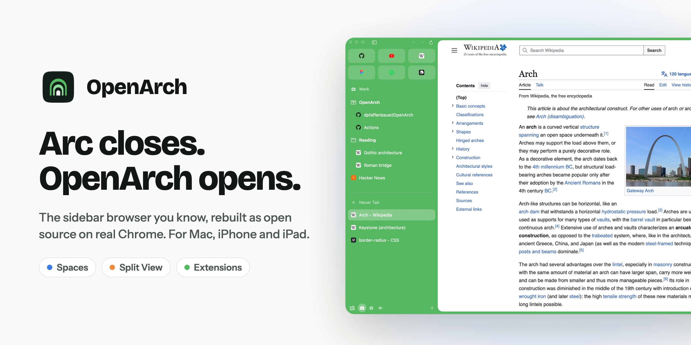

<p align="center">
  <a href="https://openarch.app"></a>
</p>

<p align="center">
  <a href="https://openarch.app"><b>Website</b></a> ·
  <a href="https://docs.openarch.app"><b>Docs</b></a> ·
  <a href="https://github.com/dpfaffenbauer/OpenArch/releases/latest"><b>Download</b></a> ·
  <a href="https://github.com/dpfaffenbauer/OpenArch/releases/tag/nightly">Nightly</a>
</p>

# OpenArch

An open-source, Chromium-based browser for macOS in the spirit of Arc:
sidebar with favorites, pinned folders and today tabs, Spaces with their own
profiles, a command bar, split view, and real Chrome extensions. With a
companion for iPhone and iPad, and folders and spaces shared as encrypted
links, without an account.

Status: early, but usable as a daily browser. Apple silicon, macOS 15 or later.

## Highlights

- **Sidebar and Spaces:** favorites, pinned folders, today tabs; each space
  with its own color, icon and profile (logins, cookies, extensions).
- **Command bar, split view, peek, library:** Arc's shortcuts and gestures,
  up to four tabs side by side, downloads and media in one place.
- **Real Chrome:** extensions with popups and side panels, DevTools, the
  password manager, H.264/AAC/HEVC, Chromium's sandbox. Netflix, Spotify
  and other DRM streaming play with Safari's engine in the same tab.
- **Import from Arc:** spaces with their themes, pinned folders and splits,
  and on request logins, passwords, history and extensions. Chrome, Edge,
  Brave, Firefox, Safari and others come over too.
- **AI on your own login:** chat with the page (⌘E), agent chats with Claude
  Code in the sidebar, Morning Brief, tidy tabs. No API key.
- **Sharing without an account:** folders and spaces as end-to-end encrypted
  links, live or one-off.
- **iPhone and iPad:** the same sidebar on WebKit, following your Mac's spaces.

Everything in detail: [docs.openarch.app](https://docs.openarch.app).

## Build and run

```sh
App/build.sh                      # fetches CEF, builds App/build/OpenArch.app
open App/build/OpenArch.app
App/build/OpenArch.app/Contents/MacOS/OpenArch --selftest   # automated checks
```

Requires Xcode 16+ (Swift 6), CMake and Ninja. The iOS app is in
`iOS/OpenArch.xcodeproj`. More, including CI, the CEF build with codecs and
the architecture: [Build from source](https://docs.openarch.app/development/build/)
and [Architecture](https://docs.openarch.app/development/architecture/).

## Layout

- `App/`: the browser (Swift/AppKit on top of CEF 156)
- `iOS/`: OpenArch for iPhone and iPad
- `Shared/`: the Swift package both use for sharing
- `relay/`: the relay for live shares, a Cloudflare Worker ([README](relay/README.md))
- `docs/`: sharing format and threat model ([sharing.md](docs/sharing.md)), App Store notes
- `docs-site/`: the documentation at docs.openarch.app ([how the pages are written](docs-site/WRITING.md))
- `website/`: openarch.app
- `scripts/`: CEF fetch, update and codec build, icons, App Store previews, the README banner (`banner.html`)

openarch.app, docs.openarch.app and share.openarch.app are Cloudflare Workers,
deployed from `main` by Cloudflare's GitHub connection (each folder's
`wrangler.toml`; the docs need Node 24).

## License

[MIT](LICENSE)
